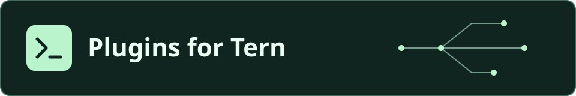

# tern-plugins

**Bring more of your workflow into Tern.**

A personal collection of plugins for the Tern terminal, maintained by [@rhdtl78](https://github.com/rhdtl78). It's independent and isn't an official Tern catalog.

[Browse plugins](#plugins) · [Quick start](#quick-start)

## Plugins

- **[OMO Native](omo-native/README.md)** — Native OmO chat in the invoking Tern shell or an explicit palette tab, with streamed replies, expandable tool activity, and saved-session resume.

## Quick start

To try OMO Native, use a local Tern session with **Native program surfaces** enabled. Install Bun and the `omo` executable, then run these commands from the root of your local checkout:

```sh
tern plugin link "$PWD/omo-native"
tern plugin list
```

Look for `omo-native` in the list. Keep the plugin directory in place while it's linked. Open Tern's command palette and choose **OMO: New Session**.

To use `omo` directly in the current Bash or Zsh pane, source `"$PWD/omo-native/shell-integration.sh"` before changing to your project. See the [OMO Native guide](omo-native/README.md) for setup, controls, and rollback.

## Resources

- [Tern Plugin SDK](https://docs.stencil.so/tern/) for writing your own plugin.
- [GitHub Issues](https://github.com/rhdtl78/tern-plugins/issues) for bug reports.

If you find the collection useful, [star it on GitHub](https://github.com/rhdtl78/tern-plugins). Have an idea for another plugin? [Suggest it in Issues](https://github.com/rhdtl78/tern-plugins/issues/new).
